# SME Quote Dashboard: quotes, sign-backs and billing for a five-company advisory group, built inside Microsoft 365 and Azure

The sales and finance teams of a Malaysian accounting and advisory group use it to see, every day, which quotes went out, which came back signed, whether the week is on target, and what has been billed and collected across all five of the group's companies. It replaced a shared Excel workbook that only one person could refresh.

Building the tables was the easy part. This page explains **how the pieces fit together**, and why each was chosen: where the data lives, how a slow manual refresh became one click, who can see it, and how we know the numbers still match the workbook.

> **About the data:** every number, company and person on this page, in the video and in the demo is made up. The real dashboard runs on the firm's own data and is private.

| | |
|---|---|
| 🖱️ **[Try the demo](https://trisglenanne9.github.io/sme-quote-dashboard/)** | the real dashboard with made-up data, in your browser, no login |
| ▶️ **[Watch the 1-minute video](https://trisglenanne9.github.io/sme-quote-dashboard/video.mp4)** | the daily work, chapter by chapter, with voiceover |
| 📘 **[User guide](docs/GUIDE.md)** | every tab, filter and definition |
| 🛠️ **[Technical architecture](docs/ARCHITECTURE.md)** | the same design in developer detail |

## How it works

The diagram plays the story in 8 steps; the caption at the top right says what is happening. Icons: Microsoft's Azure architecture icons and the Excel and SharePoint product icons.

## The problem it solves

The weekly sign-back numbers, billing and collections lived in one shared Excel workbook, fed by about 15 files: the quote master, three lead trackers, invoices from five companies, resignation lists and a collections record. **Only one person could refresh it.** Every refresh was manual: gather the latest source files, run 16 chained Power Query steps, wait, then save and share the result. It was slow, and everyone else saw whatever copy was last saved.

| | Before: the shared workbook | After: the dashboard |
|---|---|---|
| **Who can refresh** | one person | anyone with access, one click |
| **Getting the source data** | by hand: gather and update ~15 files | automatic: pulled straight from SharePoint |
| **Time to refresh** | slow | seconds |
| **How people see it** | open a copy of a shared workbook | open a web page and log in |
| **Same numbers for everyone** | only if they have the latest copy | always: one current version |
| **When a refresh breaks** | the workbook stops half-way | the last good figures stay on screen |

## The design choices, in plain terms

| Choice | Why it matters |
|---|---|
| **Leave the spreadsheets where they are** | Sales and finance keep working exactly as before. Nobody re-types data, and there is no second copy to keep in step. The dashboard only ever *reads* the files. |
| **Keep the workbook's logic, step for step** | The team already trusted the workbook's numbers. Its 16 Power Query steps were rewritten in Python one by one, so every rule, quirk and total carries over and can be checked side by side. |
| **One click instead of one person** | Anyone can press Refresh now. The engine pulls every file itself, so nobody has to gather files or own the workbook. |
| **Build on the Microsoft 365 and Azure the firm already has** | People log in with the company account they already use, and no new vendor holds the firm's data. |
| **Pay only when it is used** | Nothing runs all day waiting. The engine wakes up when someone presses Refresh, and the website runs on the free tier. |
| **Keep the data locked away** | The store holding the figures has no public door. The page gets a one-hour pass to read them, only after a company login; personal Microsoft accounts are turned away. |
| **Ask for read access to named files only** | The engine's own login can open only the SharePoint files it was explicitly granted, not the whole company drive. |

## How we know the numbers are right

- **Matched against the workbook.** A local run of the full pipeline lists every row and column that differs from the workbook's own output. Billing reconciles to the cent, and the Quote & Billing table keeps the workbook's 57 columns in the same order.
- **Every mismatch is written up.** Each one records the symptom, the cause and the fix. One tab once showed 812 quotes against the workbook's 805, because it read a table before duplicates were removed instead of the one the workbook's pivot actually uses.
- **Tested on every change.** Automatic tests with synthetic data cover the trickiest rules (yearly contract value, carry-forward value, the weekly signed-back column), and a check stops any change that would silently break one tab's code.
- **Shows its age.** The header shows when the figures were last refreshed. If a refresh fails, the previous figures stay on screen and the person who pressed Refresh is told why; a half-finished file is never saved.

## See it working

[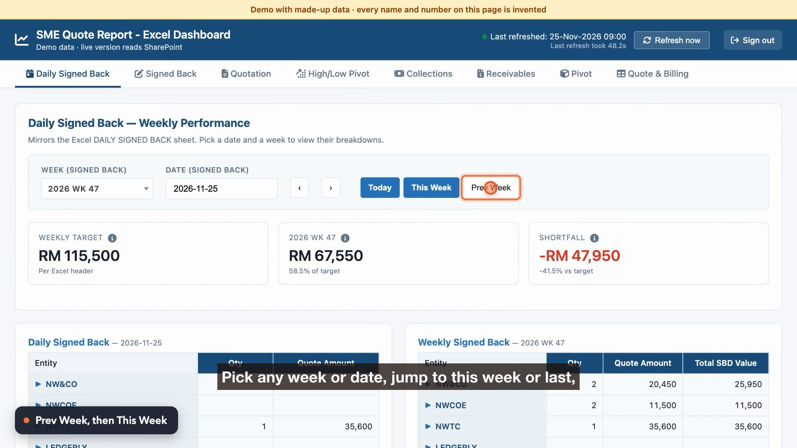](https://trisglenanne9.github.io/sme-quote-dashboard/video.mp4)

*The 1-minute walkthrough, with voiceover: this week against target · who signed back what · what's in the pipeline · which quotes to chase · billing, receivables and collections · fresh numbers on demand.* If the player doesn't open, [download the video](docs/video/sme-quote-dashboard.mp4) (MP4, 3 MB).

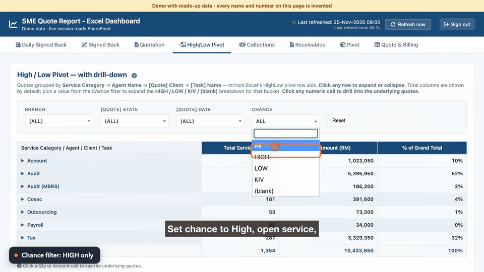

### What it shows

- **Daily Signed Back:** what was signed back today and this week, by company and department, against the weekly target.
- **Signed Back:** which quotes came back, who brought them in, how fast they converted, and what they are worth a year.
- **Quotation:** what is in the pipeline, by company and agent, at each stage: Draft, Issued, Accepted, Cancelled.
- **High/Low Pivot:** how likely each open quote is to close, by service, agent and client, so the team knows whom to chase.
- **Receivables, Collections, Quote & Billing:** every invoice, payment and billing line behind the figures, searchable and exportable.

### See where we stand

<table>
<tr>
<td width="50%"><b>This week against target</b>: signed back so far, the target and the shortfall; open a company to see its departments 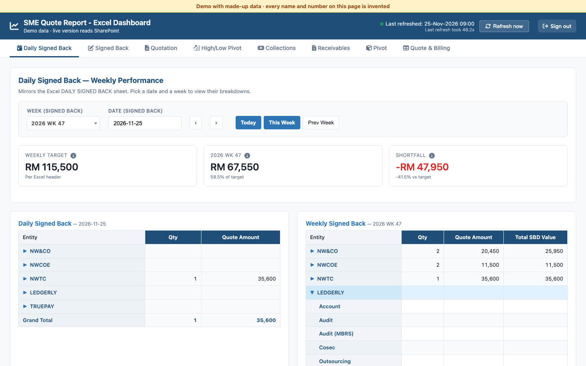</td>
<td width="50%"><b>Who signed back what</b>: every signed-back quote by service and agent, with conversion days and yearly value 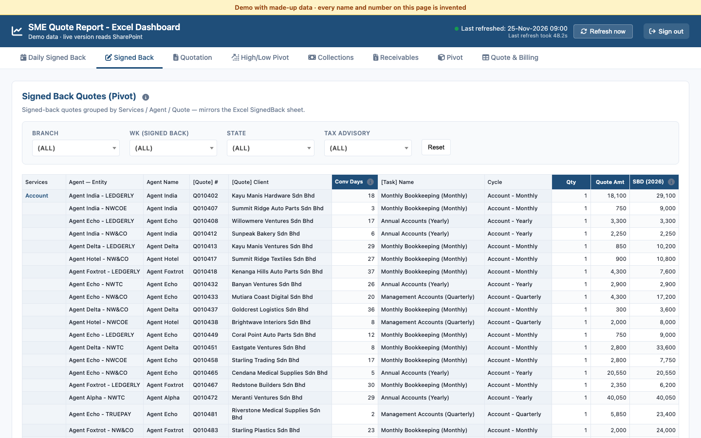</td>
</tr>
<tr>
<td colspan="2"><b>What's in the pipeline</b>: quotes by company, with amounts and yearly value 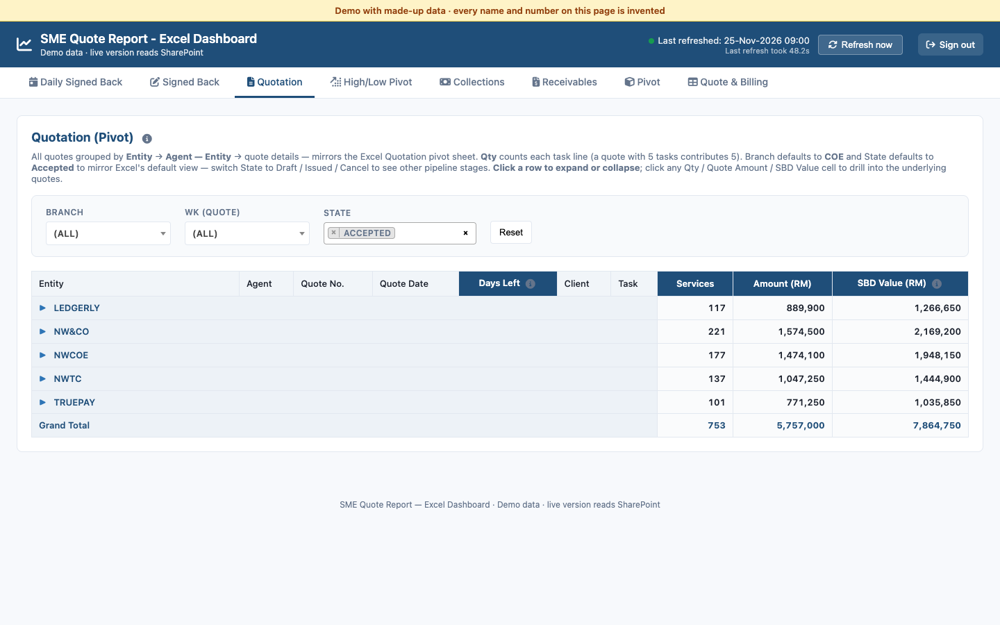</td>
</tr>
</table>

### Find the cause

<table>
<tr>
<td width="50%"><b>Filter by branch, week or state</b>: the whole table follows 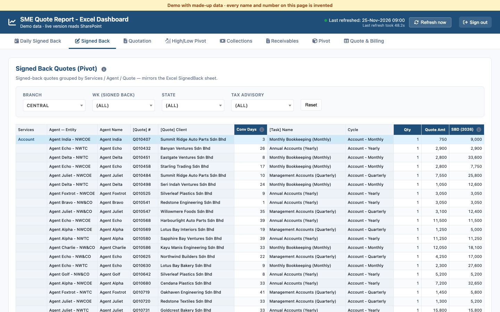</td>
<td width="50%"><b>Open a company, then an agent</b>: down to each quote and task 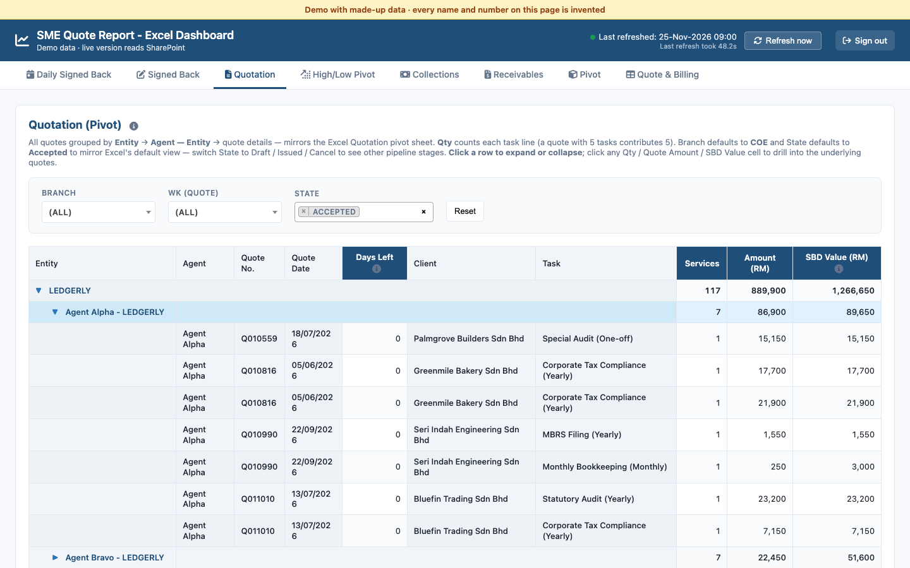</td>
</tr>
<tr>
<td width="50%"><b>Which quotes to chase</b>: set Chance to HIGH and open a service, then an agent 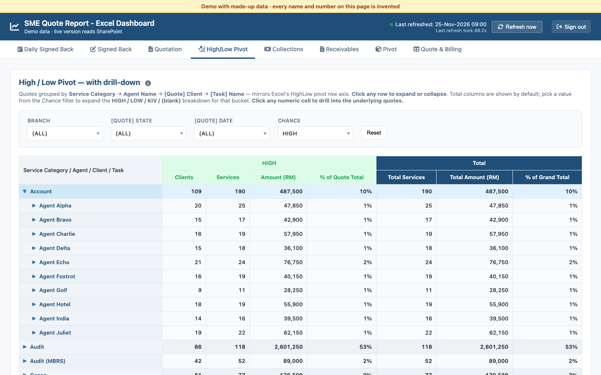</td>
<td width="50%"><b>Click any number</b>: the quotes behind it, ready to export 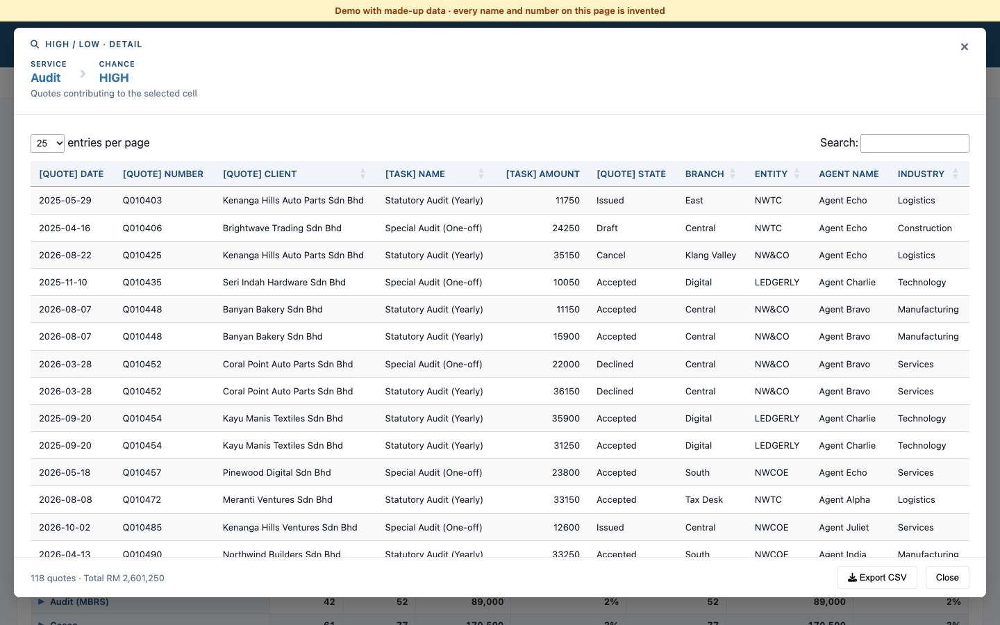</td>
</tr>
</table>

### Work with the rows

<table>
<tr>
<td width="50%"><b>Find any invoice</b>: search or filter on any column across all five companies 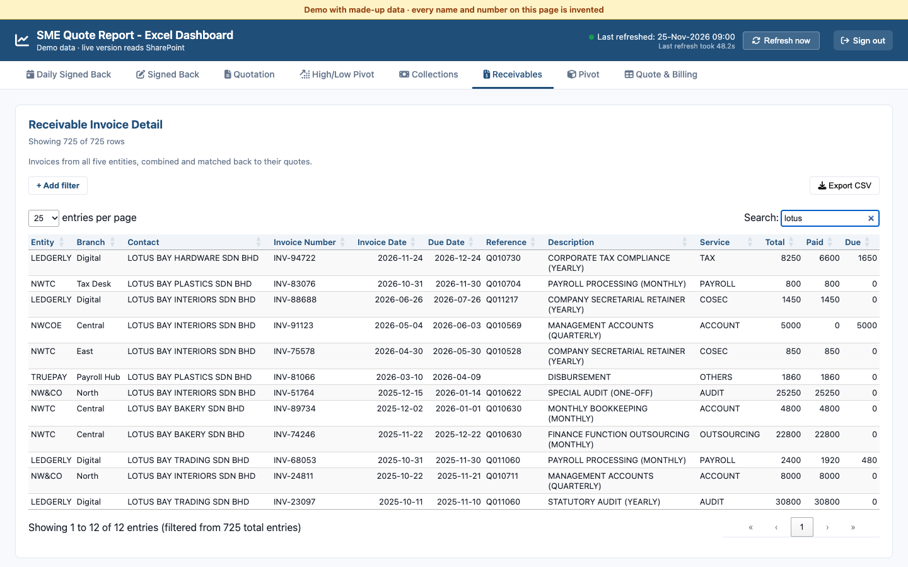</td>
<td width="50%"><b>Every billing line</b>: the workbook's 57 columns, in the same order, with Export CSV 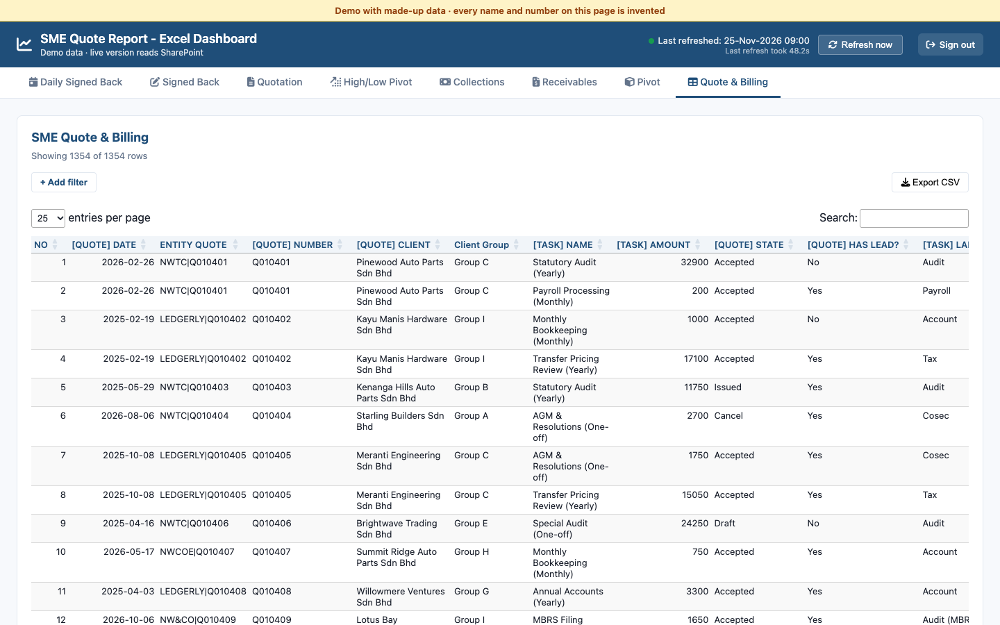</td>
</tr>
<tr>
<td colspan="2"><b>What has been paid in</b>: every payment, by company, branch and client 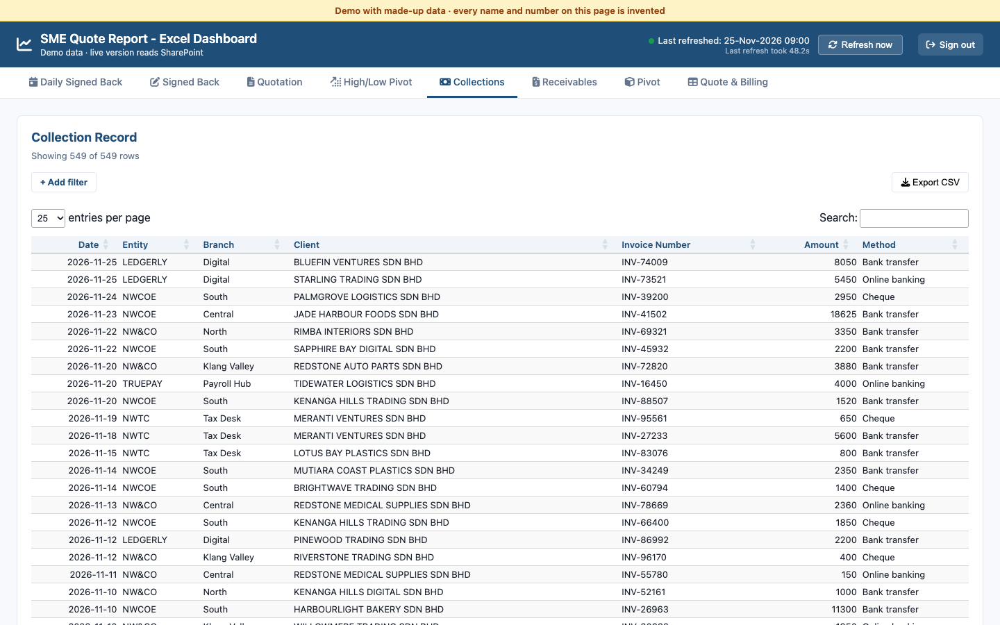</td>
</tr>
</table>

### Keep it running

<table>
<tr>
<td><b>Fresh figures on request</b>: Refresh now, and the time the figures were last refreshed 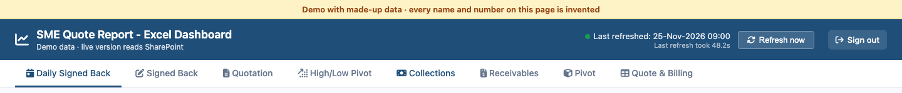</td>
</tr>
</table>

## What it is built with

All Microsoft, all inside the firm's own setup:

| Service | Its job here |
|---|---|
| **SharePoint** | where sales and finance keep the source workbooks and lists |
| **Microsoft Graph** | the read-only door the engine uses to fetch them |
| **Azure Functions** | runs the Python pipeline (pandas) and hands out the one-hour pass |
| **Azure Storage** | the locked store for the prepared figures |
| **Azure Static Web Apps** | delivers the dashboard to the browser |
| **Microsoft Entra ID** | the company login, for staff and for the engine |
| **GitLab CI/CD** | tests every change and deploys both halves from `main` |

## By the numbers

| | |
|---|---|
| Used by | the sales and finance teams of five companies |
| Source files read | about 15, never changed |
| Workbook logic | 16 Power Query steps, rewritten in Python |
| Rows behind the main table | about 6,100 |
| Refresh | one click, in seconds, by anyone (was manual, slow, one person) |
| Running cost | pay-per-use engine; website on the free tier |

## For technical readers

The developer view (every Azure service, the pipeline, the security model and the delivery pipeline) is in **[docs/ARCHITECTURE.md](docs/ARCHITECTURE.md)**, with a detailed diagram.

## Made by

**trisglenanne9**
