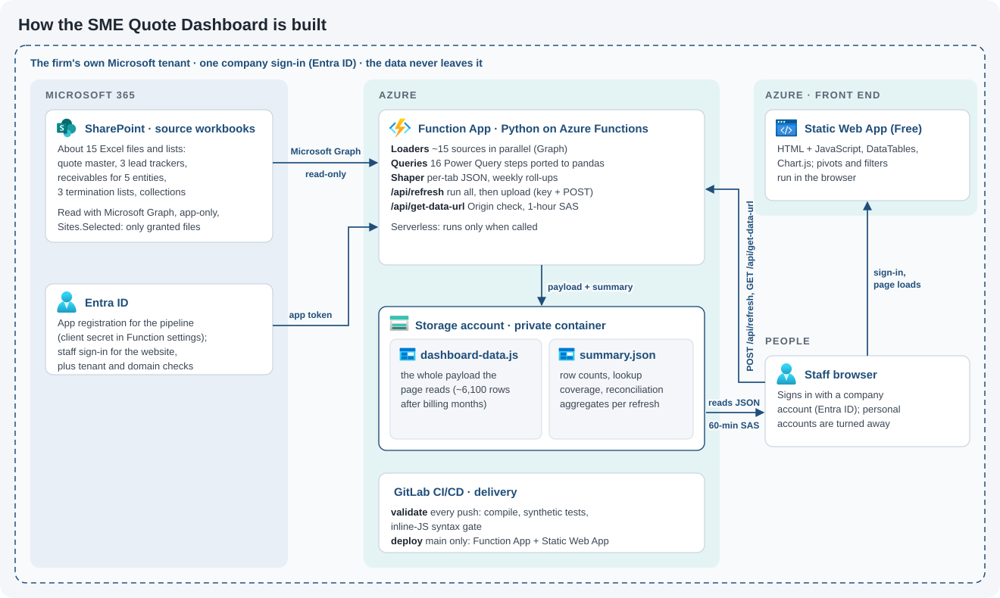

# Technical architecture

> All names, figures and screenshots in this repository are made up. The real system runs on a firm's own data and is private.
>
> This is the developer view. The plain-language overview, with the reasons behind each choice, is in the [README](../README.md#how-it-works).

## 1. The constraint that shapes it

**The numbers had to match the Excel workbook exactly.** The finance team already trusted the workbook, so the new dashboard was only useful if every row, column and total agreed with it. That is why the pipeline is a line-by-line port of the workbook's 16 Power Query (M) steps rather than a fresh design, and why the original M code is kept beside the Python as the reference.

The second constraint is cost: the front end runs on the **free tier of Azure Static Web Apps**, which cannot attach a back-end Function App. Several design choices below (calling the Function directly, the SAS link, the two-stage sign-out) follow from that.

## 2. Where everything runs

| Box | Service | What it does |
|---|---|---|
| Source workbooks | SharePoint (Microsoft 365) | Holds the ~15 Excel files and lists. Sales and finance update them; the dashboard only reads. |
| Entra ID | Microsoft Entra ID | The pipeline's own app registration (Graph, `Sites.Selected`), and staff sign-in for the website with tenant and domain checks. |
| Function App | Azure Functions, Python | Downloads the sources, runs the pandas port of the 16 Power Query steps, shapes the per-tab JSON, uploads it, and mints one-hour read links. Two HTTP endpoints: `/api/refresh` and `/api/get-data-url`. |
| Storage account | Azure Blob Storage | One private container: `dashboard-data.js` (the payload the page reads) and a summary JSON with row counts, lookup coverage and reconciliation aggregates. |
| Static Web App | Azure Static Web Apps (Free) | The dashboard itself: one HTML page with inline JavaScript, DataTables and Chart.js. All filtering and pivoting happens in the browser. |
| Delivery | GitLab CI/CD | Validates every push; deploys the Function App and the Static Web App from `main`. |

The free tier cannot link a back-end Function App, so the browser calls the Function directly: **Refresh now** posts to `/api/refresh`, and after sign-in the page asks `/api/get-data-url` for a link to the data file that expires after one hour.

## 3. Data sources

| Source | Owner | Access | Size / shape | Known quirks |
|---|---|---|---|---|
| Quote master workbook | business development | Graph file download | the largest file; one row per quote task | column names change occasionally |
| Lead trackers (3 brands) | marketing | Graph file download | one row per lead | each tracker has its own layout |
| Receivable invoices (5 entities) | finance | Graph file download | one file per entity | entity names differ between files; references are sometimes blank |
| Termination lists (audit, tax, account) | each service line | SharePoint lists via Graph | one row per client resignation | some internal field names are matched by pattern, not by exact name |
| Collection record | finance | Graph file download | one row per payment | — |

All files are read with **`Sites.Selected` / `Files.SelectedOperations.Selected`** permissions: the app can open only the sites and files an administrator explicitly granted, not the whole tenant.

## 4. Pipeline

`orchestrator.refresh_all()` loads every source **concurrently**, then runs the transforms in dependency order:

1. **Extract** — one loader per source file or list; each returns a pandas DataFrame with the workbook's column names.
2. **Clean** — trim and upper-case keys, normalise entity names, classify each invoice into a service with the same keyword table the workbook used.
3. **Combine** — build the main quote table, attach lookups (entity → business unit → service, agent → entity, position), expand each task into billing months, and match invoices and payments back to quotes.
4. **Shape** — turn the tables into the exact JSON each tab reads, including pre-built per-entity and per-service roll-ups for the weekly view.
5. **Store** — only after every step succeeds, upload `dashboard-data.js` and the summary. A failed or empty run never overwrites the last good data.

The workbook has a **circular dependency** between two helper queries; the port breaks it with a preliminary pass, exactly as the workbook effectively does.

## 5. Data model & definitions

| Term | Definition |
|---|---|
| **Quote amount** | the task's fee as quoted, per billing cycle |
| **SBD value** (signed-back value) | the task's yearly value: fee × cycle multiplier (monthly ×12, quarterly ×4, yearly ×1). Counted once per task. |
| **Signed back** | a quote with a date of signed back; counted in the week of that date |
| **Week** | weeks run Friday to Thursday, counted from the first Friday on or before 1 January, and are labelled `YYYY WK NN`, as in the workbook |
| **Billing** | what has been invoiced against the quote so far |
| **Payment / Collection** | what has been paid against those invoices |
| **Remaining to bill** | SBD value minus billing |
| **High / Low / KIV** | the agent's own estimate of how likely an open quote is to close |
| **Weekly target** | a fixed signed-back target per week, shown with the shortfall or surplus |

## 6. Refresh & monitoring

- **On demand.** The pipeline runs when someone clicks **Refresh now**; there is no timer, so it never runs against half-saved source files.
- The page header shows when the figures were **last refreshed**.
- Each refresh also writes **diagnostics** (lookup and join coverage, e.g. how many agents matched an entity) and **reconciliation aggregates** into the summary file, so a drift can be spotted without opening the full data.

## 7. Hosting & access

- **Who can open it:** staff signed in with a work Microsoft account on the firm's own email domains. Personal Microsoft accounts are refused explicitly, even if they get past the sign-in page.
- **Data access:** the data file is in a **private** container. After sign-in, the page asks the Function for a link; the Function checks the caller's origin and returns a **SAS link valid for one hour**. Without signing in there is no link, so the data cannot be fetched even by someone who knows the storage URL.
- **Sign-out** is two-stage: it clears the Static Web App session and then the Microsoft single sign-on session, because the free tier would otherwise sign the user straight back in.

## 8. Security & privacy

- **Secrets:** the Graph client secret lives only in the Function App's settings; the deploy pipeline reads the Function key from Azure at deploy time instead of storing it; the only stored CI variable is the Static Web App deploy token, masked and protected.
- **Least privilege:** the Graph app can read only the files it was granted (`Sites.Selected`).
- **Data at rest:** a single private blob, overwritten on each refresh; no database, no copies.
- **Personal data:** client and staff names are shown to signed-in staff only; nothing is sent outside the tenant and Azure subscription.

## 9. Delivery

- **Every push** runs two `validate` jobs: Python must compile, the query modules must import, the synthetic tests must pass, and every inline `<script>` in the HTML must parse, so a stray brace cannot ship green.
- **`main` is production for both halves.** A merge to `main` publishes the Function App (remote build) and builds `dist/` from `static/`, then uploads it to the Static Web App.
- **No stored Function key.** The deploy job reads the key from Azure at run time; the only stored CI variable is the Static Web App deployment token, masked and protected.
- **Local development:** a small Flask app serves the same page from a live pipeline run on local copies of the sources, and a validation script prints every difference from the workbook.

## 10. How accuracy is checked

- **Against the workbook.** `validate_locally.py` runs the full pipeline on local copies of the sources and lists every row and column that differs from the workbook's own output. Billing reconciles **to the cent**.
- **Every mismatch is written up.** Each finding records the symptom, the root cause, what was tried and what fixed it — for example, one tab briefly showed 812 quotes against the workbook's 805 because it read the un-deduplicated table instead of the pivot table the workbook actually binds to.
- **Data-free tests in CI.** Synthetic tests cover the trickiest rules (carry-forward contract value, the weekly signed-back value column, the core transforms) without needing any real data.
- **A JavaScript syntax gate.** The dashboard's script lives inside the HTML; a syntax error there makes the browser silently drop one tab's code. CI parses every inline script so that cannot ship.

## 11. Design decisions

| Decision | Why | Rejected |
|---|---|---|
| Port the M code line by line | the numbers had to match the trusted workbook | redesigning the model (faster to write, impossible to reconcile) |
| Python + pandas in an Azure Function | pay-per-run; the same code runs locally for testing | keeping the refresh inside Excel |
| One pre-shaped JSON file | tabs and filters respond instantly; SharePoint is hit once per refresh | querying SharePoint on every page view |
| Static Web App, free tier | Microsoft sign-in included at no cost | an always-on web server |
| On-demand refresh | no runs against half-edited source files; no idle cost | a nightly timer |
| GitLab CI, deploy on `main` | a solo project: tests guard the branch without mandatory review | manual deploys only |

## 12. Known limits

- **Desktop first.** The tables are wide; the layout is not designed for phones.
- **One payment rule is still open.** Invoices with a blank reference are matched to quotes by client and service in the workbook; the port leaves that fallback off for now, which under-counts payments by a small, known amount.
- **Some SharePoint list fields are matched by pattern** rather than by their exact internal name, so a renamed column could be missed.
- **No scheduled refresh,** so the data is only as fresh as the last click (the header always says when that was).
