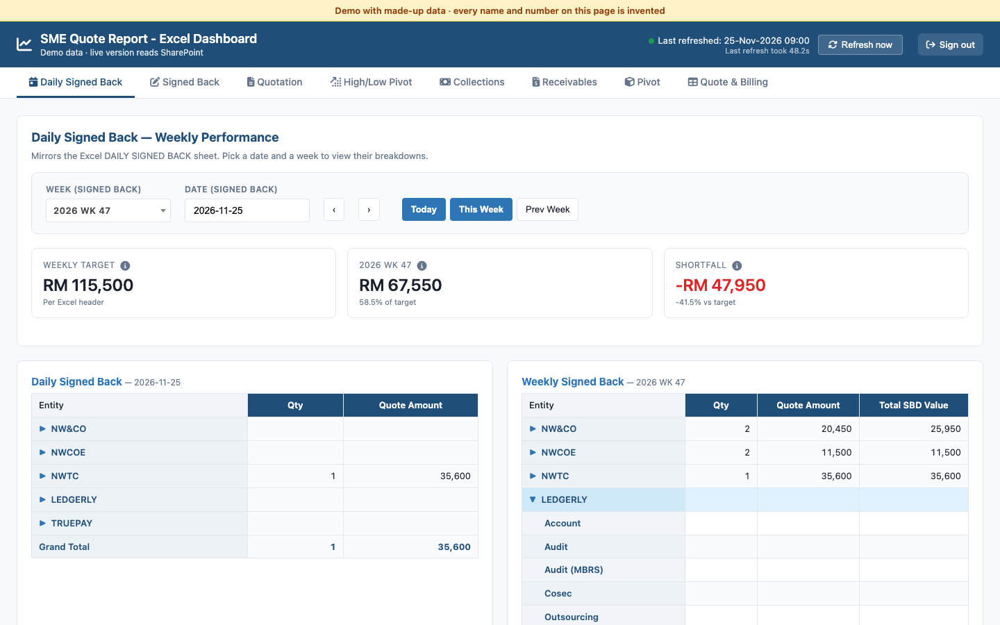
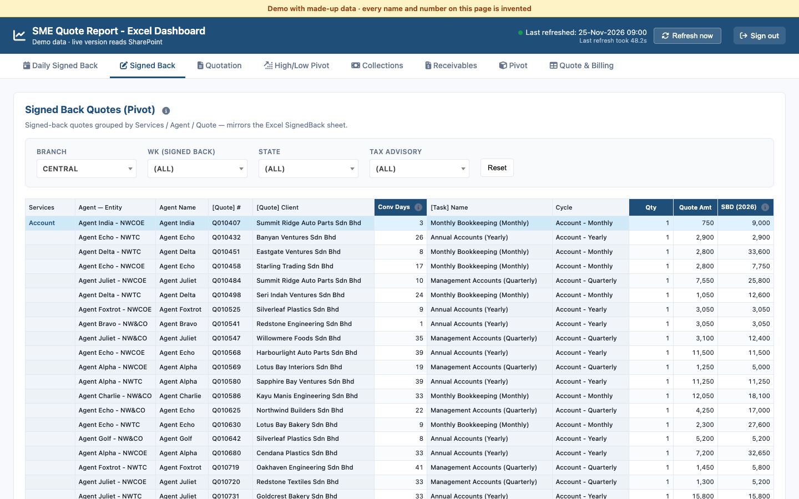
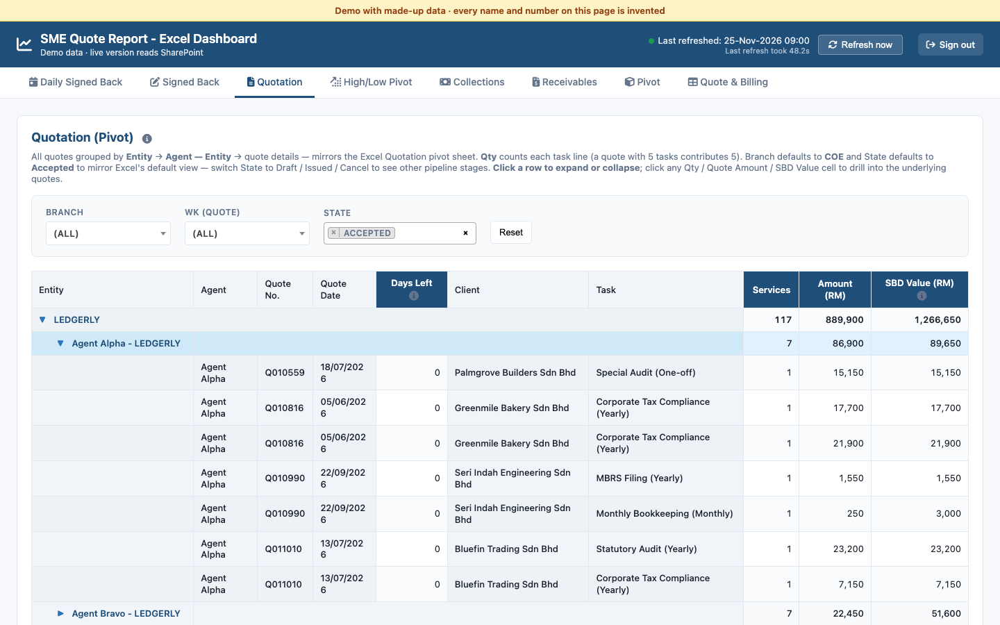
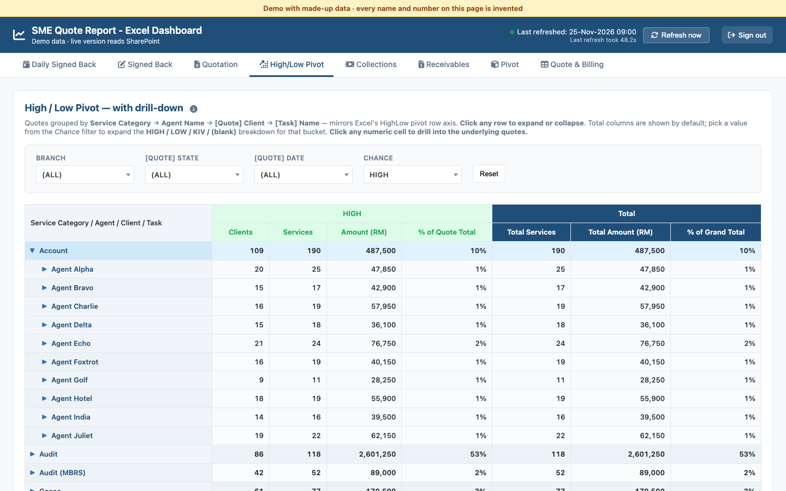
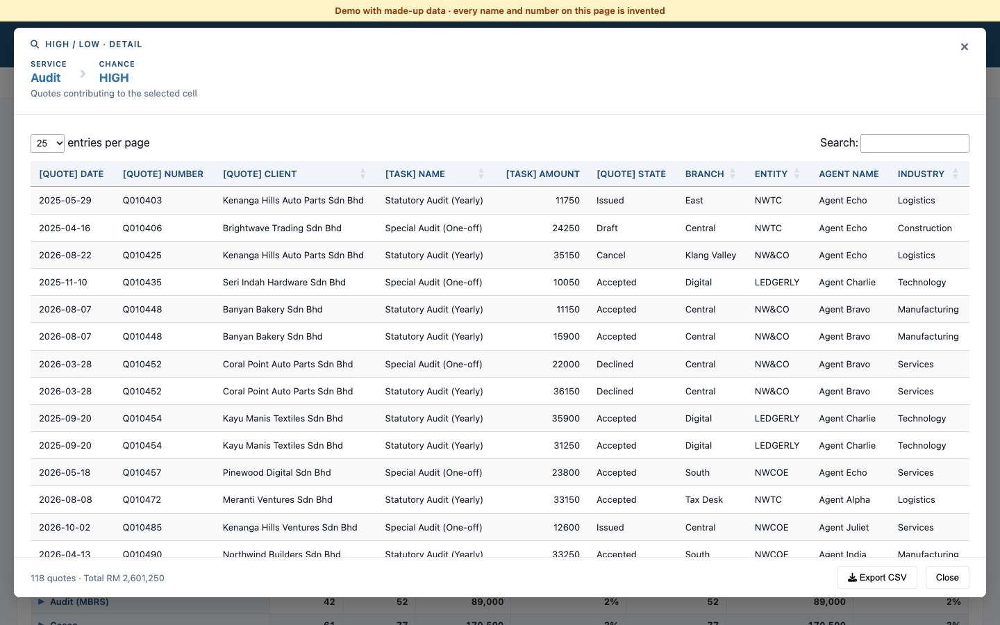
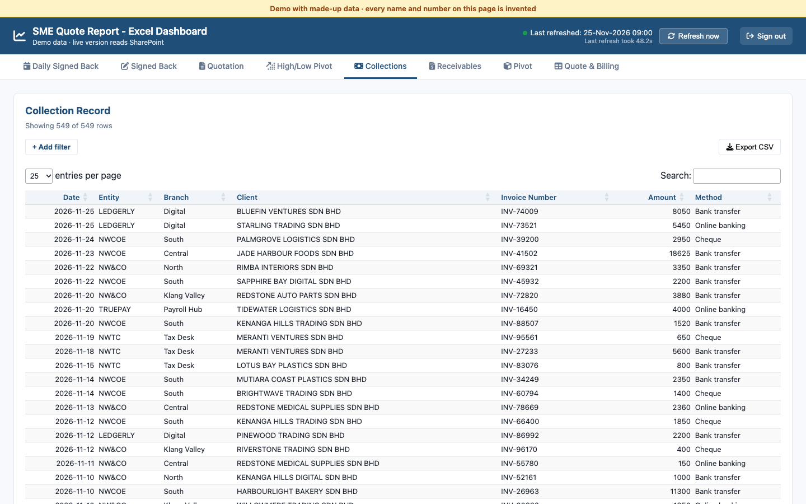
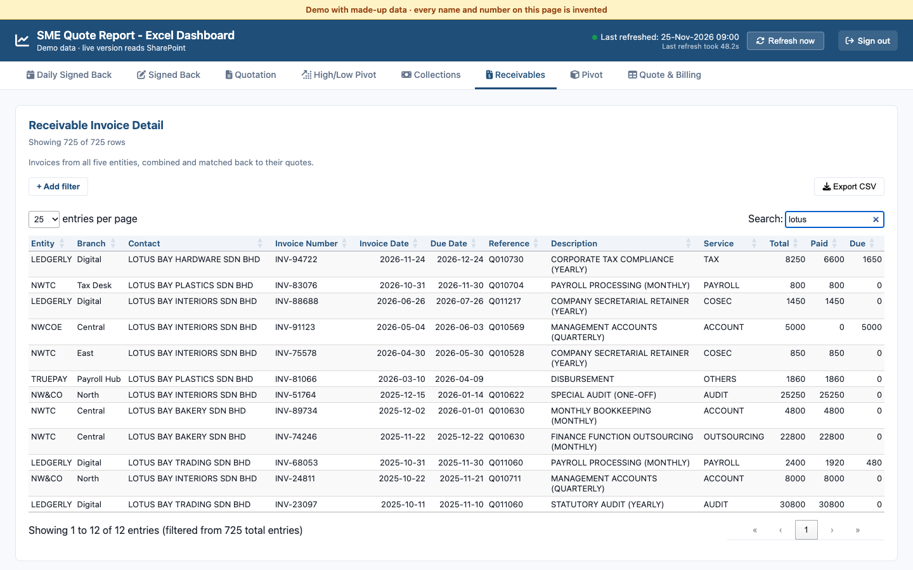
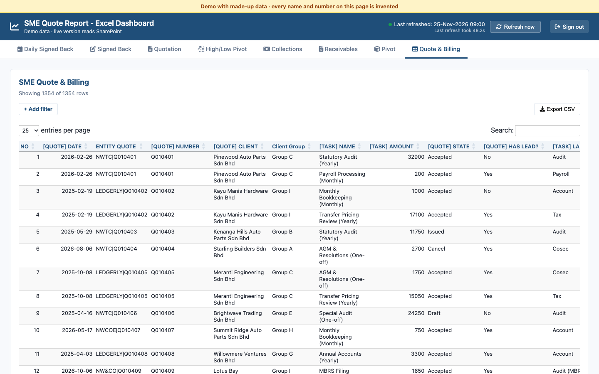

# User guide

> All names, figures and screenshots in this repository are made up. The demo uses five fictional companies (NW&CO, NWCOE, NWTC, LEDGERLY, TRUEPAY) and fictional clients and agents.

## 1. Who uses it and for what

- **Business development** — how many quotes went out and came back this week, per entity and per agent, and which open quotes are worth chasing.
- **Finance** — what has been billed and collected against each signed quote, and what is still to bill.
- **Management** — the weekly signed-back total against target.

## 2. The routine

| When | What |
|---|---|
| Any time the source files change | Anyone presses **Refresh now**; the engine pulls every file from SharePoint and the page reloads with the new figures in seconds. |
| Every morning | Open **Daily Signed Back**: today's sign-backs and this week's total against the target. |
| Weekly sales review | **Signed Back** and **Quotation** for the quotes behind the numbers; **High/Low Pivot** to decide which open quotes to chase. |
| Billing and collection work | **Quote & Billing**, **Receivables** and **Collections**: search, filter, and export to CSV. |

## 3. The views

### Daily Signed Back

**Answers:** how much was signed back today and this week, by entity, against the weekly target?
- **Cards:** weekly target, this week's quote amount (with % of target), and the shortfall (red) or surplus (green).
- **Daily table:** quotes signed back on the chosen date, by entity. Click ▶ to see each entity's departments.
- **Weekly table:** the same for the chosen week, plus **Total SBD value** (the yearly value of what was signed).
- **Filters:** week, date, ‹ › to step a day, and **Today / This Week / Prev Week** shortcuts.

### Signed Back

**Answers:** which quotes came back, who brought them in, how fast, and what are they worth per year?
- One row per signed-back quote, grouped by service; columns include agent, client, conversion days, task, cycle, quote amount and SBD value.
- **Filters:** branch, week signed back, state, tax advisory (TA / non-TA), **Reset**.

### Quotation

**Answers:** what is in the pipeline, by entity and agent, at each stage?
- Grouped by entity → agent → quote. **Services** counts task lines (a quote with five tasks counts five).
- Opens on **Accepted**; switch the state filter to Draft, Issued or Cancel to see earlier or lost stages.
- Click a row to expand it; click any number to see the quotes behind it.
- **Filters:** branch, week quoted, state, **Reset**.

### High/Low Pivot

**Answers:** how likely is each open quote to close?
- Grouped by service → agent → client → task, with total services, total amount and share of the grand total.
- Pick a value in **Chance** to split the totals into HIGH, LOW, KIV and blank.
- Click any number to drill into the underlying quote lines.
- **Filters:** branch, quote state, quote month, chance, **Reset**.

### Collections

**Answers:** what has been paid in, when, and by whom?
- One row per payment. Use **+ Add filter** to filter any column, the search box to find a client or invoice, and **Export CSV** to download what is on screen.

### Receivables

**Answers:** what has each entity invoiced, and what is still due?
- Every invoice from all five entities in one table, with the quote it belongs to (from the invoice reference) and its paid and due amounts.
- Same tools as Collections: column filters, search, CSV export.

### Pivot and Quote & Billing

**Answer:** what are the exact rows behind every other view?
- **Pivot** is the de-duplicated quote table that Quotation and High/Low read.
- **Quote & Billing** has one row per quote task per billing month, with all 57 columns of the original workbook sheet, in the same order.

## 4. Definitions

| Metric | Meaning |
|---|---|
| Quote amount | the task fee as quoted, per billing cycle |
| SBD value | yearly value of a signed task: fee × 12 (monthly), × 4 (quarterly), × 1 (yearly or one-off) |
| Signed back | the quote has a date of signed back |
| Conversion days | days from quote date to signed-back date |
| Week | Friday to Thursday, labelled `YYYY WK NN` |
| Billing | invoiced so far against the quote |
| Payment / Collection | paid so far against those invoices |
| Variance | billing minus payment |
| Remaining to bill | SBD value minus billing |
| High / Low / KIV | the agent's estimate of how likely an open quote is to close |
| Weekly target | the fixed signed-back target per week |

## 5. "Why does this number differ from …?"

- **… the old Excel workbook?** It shouldn't — the dashboard is checked against it. Check both were refreshed from the same source files at the same time.
- **… between Signed Back and Daily Signed Back?** Signed Back counts each *quote* once; Daily Signed Back counts each *task line*. Amounts agree; counts can differ.
- **… between Quotation and Quote & Billing row counts?** Quote & Billing repeats a task for every billing month; Quotation does not.
- **… Payment for one quote looks low?** Invoices without a quote reference are not yet matched to a quote (a known, small gap — see Architecture › Known limits).

## 6. When something looks wrong

| Symptom | Likely cause | What to do |
|---|---|---|
| Numbers look old | nobody has refreshed since the sources changed | click **Refresh now** |
| "Refresh failed" message | a source file was moved, renamed, or open with unsaved changes | check the file in SharePoint, then refresh again; the old data stays visible meanwhile |
| One tab is blank but others work | a script error in that tab | report it; this is what the CI syntax check is meant to prevent |
| A quote has the wrong entity or agent | the lookup tables in the source workbook | fix the lookup in the source file and refresh |
| "Access restricted" after sign-in | signed in with a personal or non-firm account | sign out and sign in with your work account |
